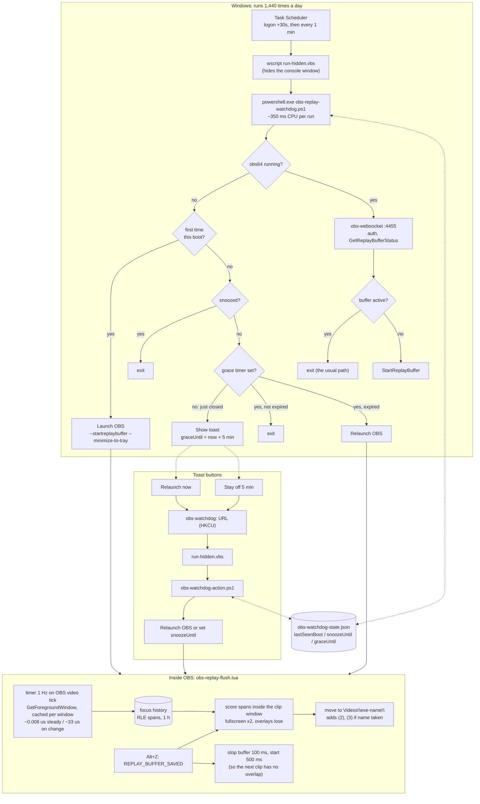
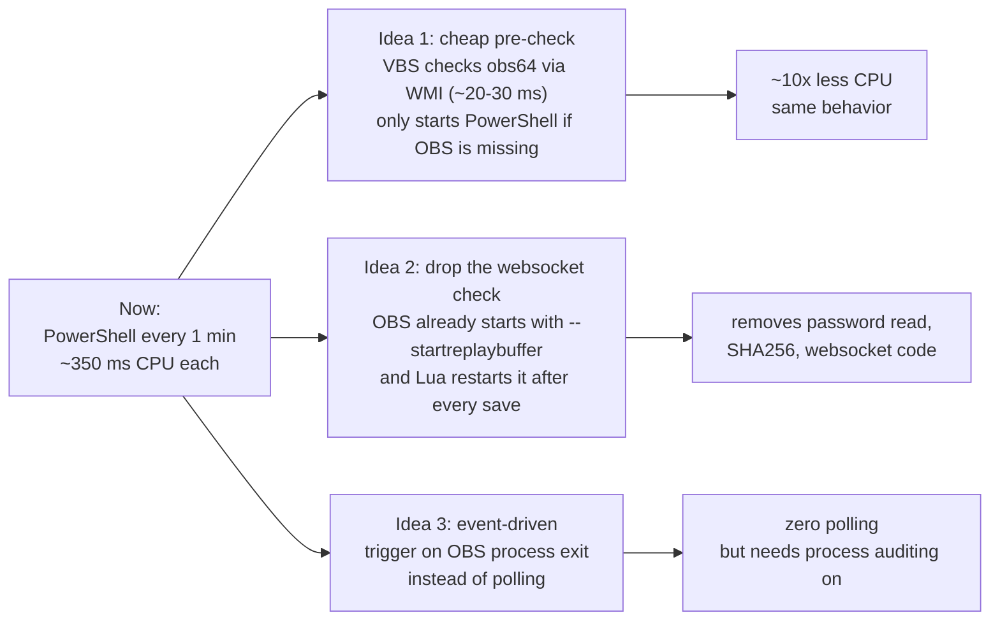

# OBS Clip System: Flow + Simplification Brainstorm

> **SUPERSEDED 2026-09-24.** Parts of this file describe the OLD design (websocket buffer check, `run-hidden.vbs` as the task action, `--disable-shutdown-check`). The current, tested setup is in **OBS-REBUILD-FROM-SCRATCH.md** (flow chart: `OBS-flow.png` / `OBS-flow.mmd`). Kept for history only.

All costs below were measured on this PC on 2026-09-24 unless marked otherwise.

## 1. The whole flow

## 2. Where the cost actually is

| Piece | How often | Cost (measured) | Per day |
|---|---|---|---|
| **Watchdog PowerShell** | every minute, 24/7 | ~350 ms CPU (~140-200 ms of that is just starting PowerShell) | **~8.5 min CPU/day**, plus 1,440 process launches |
| wscript wrapper | every minute | tiny, starts and exits | small |
| Lua focus sampler | 1/sec while OBS runs | ~0.008 us steady, ~33 us on window change | under 1 ms/day |
| Clip scoring + move | per Alt+Z | microseconds, rename is instant (same drive) | nothing |
| Buffer flush | per Alt+Z | ~0.6 s gap in the buffer after a save | nothing (CPU) |
| **NVENC AV1 encode** | constantly | 0.0% skipped frames, 0.088 ms median GPU encode | the real cost, but it's the whole point |
| **RAM replay buffer** | constantly | ~3 GB when full (600 s at ~42 Mbps), 4 GB cap never reached | the real cost |

**The takeaway:** the scripts are almost free except the watchdog. It launches a full PowerShell every minute just to confirm that nothing changed, which is 99.9% of runs. Encoding and the RAM buffer are the only big costs, and they are the feature itself.

## 3. Simplification ideas (ranked by benefit/effort)

### Idea 1: VBS pre-check (recommended, safest)
`run-hidden.vbs` checks for `obs64.exe` via WMI first. **Measured: ~16-31 ms CPU**, vs ~350 ms for the PowerShell run. It starts PowerShell only when OBS is not running, or once every N minutes for the buffer health check.
- Saves about **90% of the watchdog CPU**. Behavior doesn't change.
- Risk: very low. The logic in the `.ps1` stays exactly the same.

### Idea 2: drop the websocket "is the buffer on?" check
Why it exists: if the buffer gets stopped while OBS stays open, this turns it back on.
When can that happen? A manual stop in the UI, or the Lua flush fails to restart after a save.
- The Lua script **could handle it itself**: on `REPLAY_BUFFER_STOPPED` without `restarting`, restart it anyway. Or check `obs_frontend_replay_buffer_active()` on its existing 1 Hz tick for free.
- Then the watchdog only has to answer "is OBS running?". That removes the password read, the SHA256 auth, the 60 lines of websocket code, and the need for the websocket server to be on at all.
- Trade-off: you could no longer intentionally stop the buffer while keeping OBS open. It would restart within a second, not a minute. You'd probably want that anyway.

### Idea 3: event-driven instead of polling
Replace "every 1 minute" with a trigger on the event "obs64.exe exited" (Security log 4689, needs process-termination auditing turned on), plus the logon trigger.
- Zero polling. The watchdog runs only when OBS actually closes.
- Catch: the 5-minute "no answer, relaunch anyway" timer still needs something to fire later. That could be a one-shot scheduled task created when the toast is shown. More moving parts, so it's less simple even though it's lighter.

### Idea 4 (small): shorter replay buffer
Measured from your last 6 Fortnite clips: a full buffer is **600 s at ~2.8-3.0 GB (~42-45 Mbps)**, and a calm stretch is ~1.6 GB (22 Mbps). So the **10-minute time limit is what ends clips, not the 4 GB cap**. Clips shorter than 600 s (416, 524, 547 s) are saves made less than 10 min after the previous save, since each save flushes the buffer.
- If you never need more than ~3 min back: `RecRBTime=180` would hold ~0.9 GB instead of ~3 GB, **saving about 2 GB RAM**. CPU/GPU stay the same, because encoding runs either way.
- Keeping 10 min costs RAM, not frames. Only worth changing if RAM is ever tight.

### Not worth changing
- **The Lua sampler.** It's already negligible (0.000001% of a core), and it's the part that makes sorting smart.
- **The flush.** It's only a ~0.6 s gap right after a save, and it's why clips don't repeat footage.
- **run-hidden.vbs.** It's needed for zero window flash. Idea 1 builds on it anyway.

## 4. Correction found while making this chart

Earlier docs (and a comment in the Lua) said the sampler "runs on the script thread, never render or encode, so it cannot drop frames." **That was wrong.** The OBS source (`shared/obs-scripting/obs-scripting-lua.c`) shows that Lua `timer_add` callbacks run from `lua_tick`, which is registered with `obs_add_tick_callback`, meaning **OBS's video/render tick**. It's still harmless, but only because it's tiny (~33 us worst case against a 16,667 us frame), not because of which thread it's on. The comment and all three docs are now corrected.
